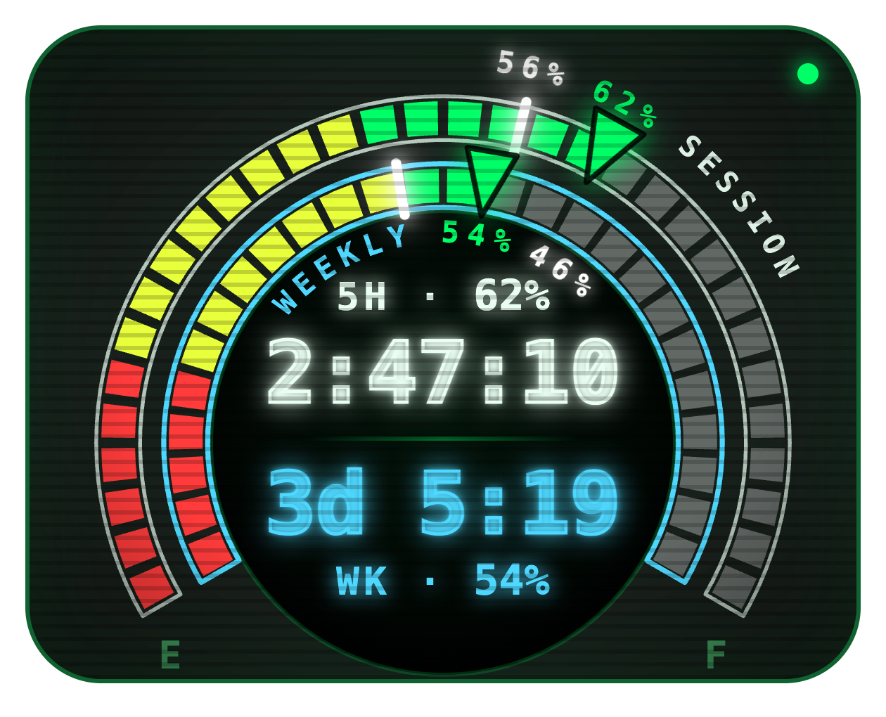

# Claude Usage Clock

A small always-on-top desktop widget for macOS that shows how much of your Claude Code usage allowance is left, styled like a fuel gauge.

<p align="center"></p>

- **Outer ring: 5-hour session.** **Inner ring: weekly limit.**
- Lit segments show the allowance left (green → yellow → red as it runs low). Gray segments are used up.
- The **triangle** on each ring points at the % left and shows that number beside it.
- The glowing **white tick** shows where an even pace would put you, which is the % of the time window still remaining.
- The centre shows the countdown until each limit resets.
- Hover for details (pace, projected run-out time), refresh ↻, quit ✕, and two colour swatches to pick the session and weekly colours.

## Requirements

- macOS (it reads your Claude Code login from the macOS keychain)
- [Node.js](https://nodejs.org)
- [Claude Code](https://claude.com/claude-code), logged in with a Claude subscription

## Run

```sh
git clone https://github.com/Sivx/Claude-Usage-Clock.git
cd Claude-Usage-Clock
npm install
npm start
```

### Optional: a clickable app

To get a **Claude Clock** app you can open from Spotlight or keep in the Dock, run this from the project folder:

```sh
osacompile -o ~/Applications/"Claude Clock.app" \
  -e "do shell script \"open -a '$PWD/node_modules/electron/dist/Electron.app' --args '$PWD'\""
```

If you move the project folder, run it again.

## How it works

Every 5 minutes the widget reads the OAuth token that Claude Code stores in your keychain and asks Anthropic's usage endpoint how much of each limit you've used. The token never leaves your machine except in that request to Anthropic.

The usage endpoint is undocumented, so this could stop working if Anthropic changes it. This project is not affiliated with Anthropic.

## License

MIT
